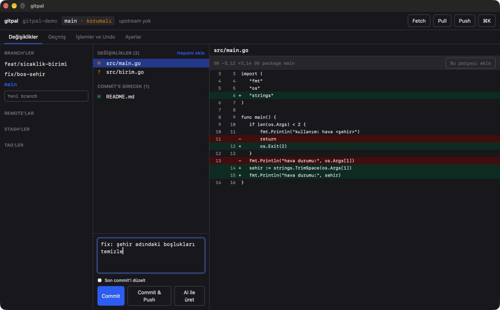
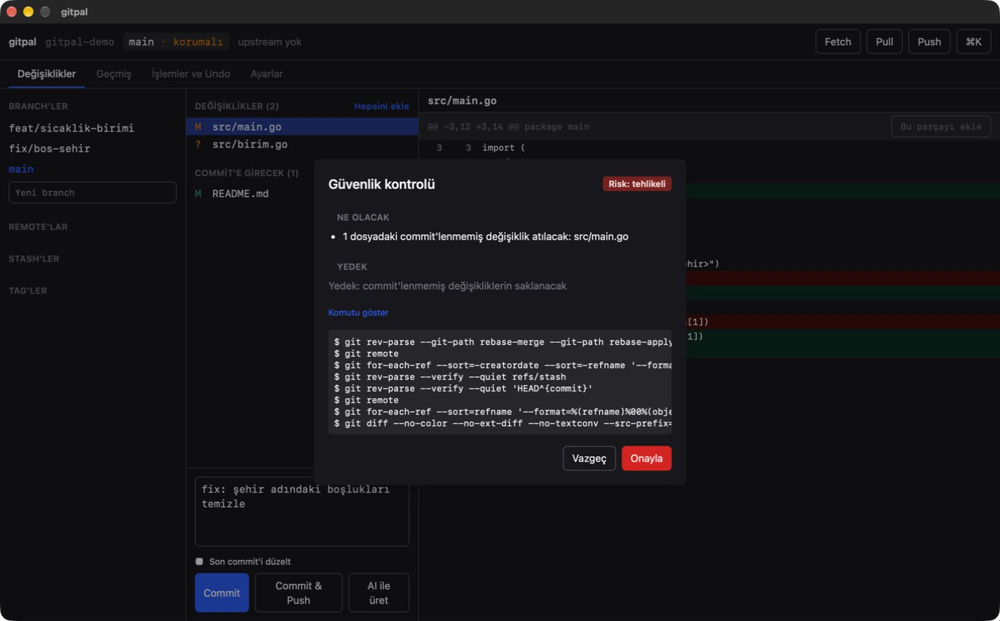
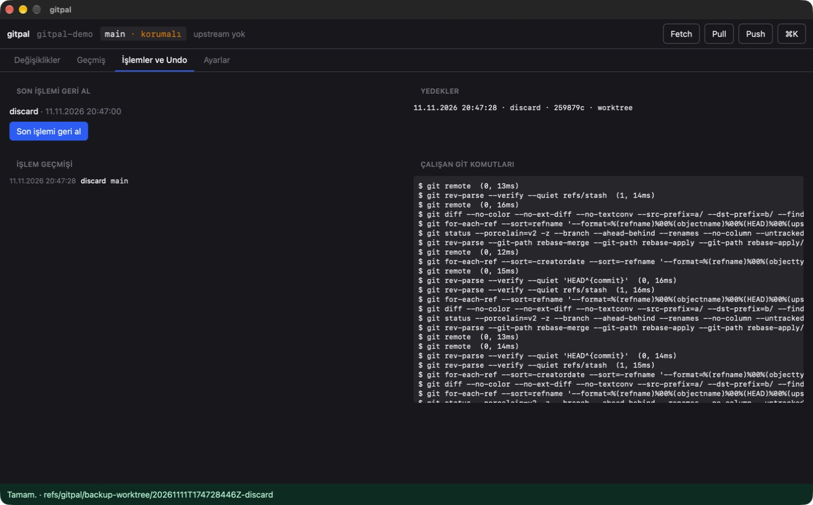
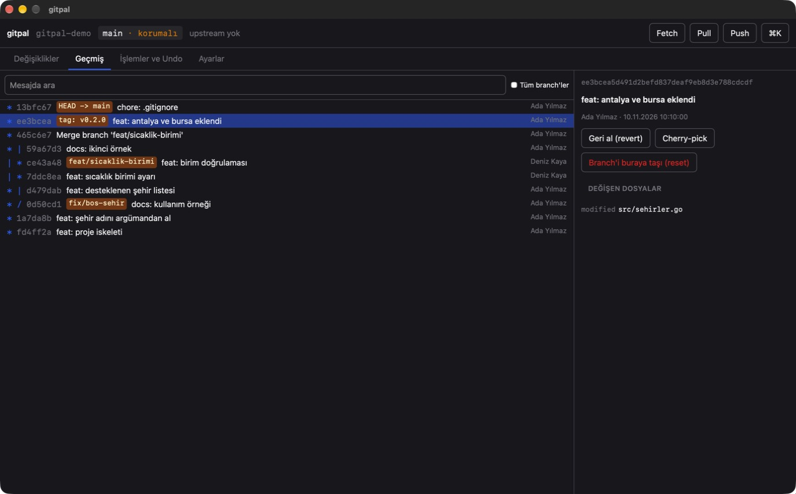
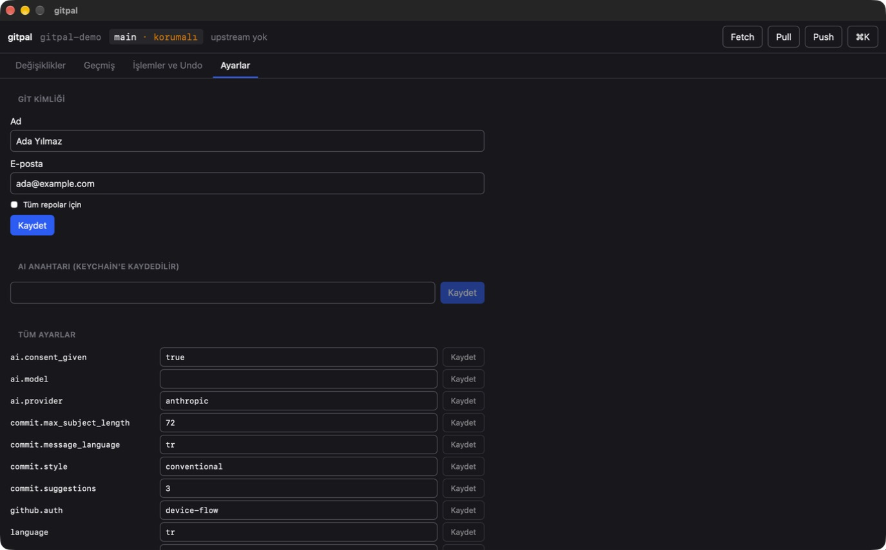

<div align="center">


# gitpal

**Git'in günlük akışını tek yerden, güvenli ve hızlı yürüt.**

Geri dönüşü zor her işlem önce ne yapacağını söyler, yedek alır ve `gitpal undo` ile geri alınır.
Terminalde ve masaüstünde aynı çekirdek, aynı güvenlik katmanı.

[](https://github.com/muhammedeminalan/gitpal/actions/workflows/ci.yml)
[](https://github.com/muhammedeminalan/gitpal/releases/latest)
[](go.mod)


[Kurulum](#kurulum) · [Hızlı başlangıç](#hızlı-başlangıç) · [Ekran görüntüleri](#ekran-görüntüleri) · [Güvenlik modeli](#güvenlik-modeli) · [Komutlar](#komutlar)



</div>

## Neden gitpal?

Git güçlüdür ama affetmez: yanlış branch'e atılan bir force push, `reset --hard` ile kaybolan bir öğleden sonra,
"bunu geri almanın komutu neydi?" diye geçen dakikalar. gitpal bu anlar için yazıldı.

- **Tehlikeli işlem sessizce çalışmaz.** Önce ne olacağını görürsün: kaç dosya, hangi commit'ler, hangi branch.
- **Her tehlikeli işlemden önce yedek alınır.** Çalışma alanına dokunmadan, `git branch`'te görünmeyen bir ref'e.
- **Son işlem tek komutla geri gelir.** `gitpal undo`.
- **Hiçbir şey gizli değil.** gitpal arka planda hangi `git` komutunu çalıştırdığını her zaman gösterebilir; kullanırken git öğrenirsin.

## Özellikler

| | |
|---|---|
| **Tek akış** | `gitpal save`: dosya seç → commit mesajı → push. Üç komut yerine bir tane. |
| **Güvenlik katmanı** | Her işlem bir risk sınıfına girer; tehlikeli olanlar onay ister, kritik olanlar branch adını yazdırır, korumalı branch'e force push hiç yapılamaz. |
| **Yedek ve undo** | discard, `reset --hard`, rebase, branch silme öncesi otomatik yedek. `gitpal undo` son işlemi geri alır. |
| **AI commit mesajı** | İsteğe bağlı. Anthropic, OpenAI uyumlu servisler ya da yerelde Ollama. Sırlar gönderilmeden önce temizlenir. |
| **Şeffaflık** | `--explain` (terminal) ve "Komutu göster" (masaüstü) çalışan her git komutunu listeler. `--dry-run` hiçbir şeyi değiştirmeden sonucu gösterir. |
| **Üç arayüz, tek çekirdek** | Komut satırı, terminalde etkileşimli ekran (TUI) ve masaüstü uygulaması aynı Go çekirdeğini kullanır. |
| **GitHub** | Repo, pull request, issue, release ve Actions durumu terminalden. |
| **Tek dosya** | Kurulum için Go, Python ya da Node gerekmez. Türkçe ve İngilizce arayüz. |

## Ekran görüntüleri

Görüntüler v1.0.0 macOS uygulamasından, örnek bir repoda alındı.

### Değişiklikler, diff ve commit

En üstteki görüntü: solda branch'ler, ortada değişen dosyalar, sağda seçili dosyanın diff'i. Dosyaları tek tek ya
da parça parça (hunk) commit'e ekleyebilir, mesajı yazıp `Cmd/Ctrl+Enter` ile commit'leyebilirsin.
`main · korumalı` etiketi, korumalı bir branch'te olduğunu hatırlatır.

### Güvenlik kontrolü

Bir dosyadaki değişikliği atmak geri dönüşü olmayan bir işlemdir. gitpal işlemi çalıştırmadan önce risk sınıfını,
tam olarak ne olacağını ve hangi yedeğin alınacağını gösterir. "Komutu göster" arka planda çalışan git komutlarını
açar.



### İşlemler ve Undo

gitpal'ın bu repoda yaptığı her işlem kayıt altındadır. Son işlem tek düğmeyle geri alınır; alınan yedekler ve
çalışan git komutları aynı ekranda listelenir.



### Geçmiş

Commit geçmişi branch grafiğiyle, branch ve tag etiketleriyle görünür. Bir commit seçildiğinde değişen dosyalar
ve o commit için yapılabilecekler (revert, cherry-pick, reset) açılır; hepsi güvenlik katmanından geçer.



### Ayarlar

Git kimliği, AI anahtarı (işletim sisteminin keychain'ine kaydedilir, dosyaya yazılmaz) ve tüm ayarlar tek ekranda.



### Terminalde

Aynı güvenlik katmanı komut satırında da çalışır. Aşağıdakiler gerçek çıktıdır:

```console
$ gitpal status
Branch: main
Upstream yok (ilk push'ta ayarlanır)

Commit'e girecek (staged):
  M  README.md

Değişmiş, henüz eklenmemiş:
  M  src/main.go

Yeni dosyalar (untracked):
  ?  src/birim.go
```

`--dry-run` hiçbir şeyi değiştirmeden ne olacağını söyler:

```console
$ gitpal discard src/main.go --dry-run
Risk: tehlikeli
Ne olacak:
  - 1 dosyadaki commit'lenmemiş değişiklik atılacak: src/main.go
Yedek: commit'lenmemiş değişikliklerin saklanacak
Kuru çalıştırma: hiçbir şey değişmedi.
```

Tehlikeli bir işlem `--yes` ile bile onaysız geçmez. Onay verecek biri yoksa (bir script içinde) gitpal reddeder
ve `3` koduyla çıkar:

```console
$ gitpal discard src/main.go --yes
Hata: Bu işlem açık onay gerektiriyor ve onay verebilecek biri yok (`--yes` tehlikeli işlemlerde geçerli değildir).
```

## Kurulum

Gereksinim: bilgisayarda **git 2.30+** kurulu olmalı.

### Masaüstü uygulaması

[Son sürümden](https://github.com/muhammedeminalan/gitpal/releases/latest) sistemine uygun dosyayı indir:

| Sistem | Dosya | Kurulum |
|---|---|---|
| macOS (Apple Silicon) | `gitpal_<sürüm>_macos_arm64.dmg` | Aç, `gitpal`'ı Applications'a sürükle |
| Windows (64 bit) | `gitpal-gui_windows_amd64.exe` | Çift tıkla (kurulum yok). WebView2 gerekir; Windows 11'de hazır gelir |
| Linux (64 bit) | `gitpal-gui_linux_amd64` | `chmod +x` ve çalıştır (`libgtk-3`, `libwebkit2gtk-4.1` gerekir) |

> [!NOTE]
> Dosyalar **imzalı değil** (Apple / Microsoft geliştirici imzası yok), bu yüzden ilk açılışta sistem uyarır.
> macOS: Sistem Ayarları → Gizlilik ve Güvenlik → "Yine de Aç". Windows: SmartScreen penceresinde "Ek bilgi" →
> "Yine de çalıştır". Intel Mac için arayüz dosyası yok (terminal sürümü var).

### Terminal sürümü

**macOS / Linux**

```bash
curl -fsSL https://raw.githubusercontent.com/muhammedeminalan/gitpal/main/scripts/install.sh | sh
```

`~/.local/bin` altına `gitpal` ve kısa adı `gp`'yi kurar. Arşiv, sürümle yayımlanan `checksums.txt` ile doğrulanır;
tutmazsa hiçbir şey kurulmaz. Sürüm ve klasör: `GITPAL_VERSION=1.0.0 GITPAL_PREFIX=/usr/local/bin sh install.sh`.

**Windows (PowerShell)**

```powershell
irm https://raw.githubusercontent.com/muhammedeminalan/gitpal/main/scripts/install.ps1 | iex
```

`%LOCALAPPDATA%\Programs\gitpal` altına kurar, kullanıcı PATH'ine ekler, `gp` kısa adını oluşturur.

**Debian / Ubuntu / Fedora:** sürüm sayfasındaki `.deb` / `.rpm` paketleri (`gp` bağlantısıyla gelir).

Kurulumdan sonra ortamı kontrol et:

```bash
gitpal doctor
```

### Kaynaktan

```bash
make build        # bin/gitpal
make install      # GOPATH/bin altına
make gui          # bin/gitpal-gui (Node 22+ ve cgo gerekir; Linux'ta libgtk-3-dev ve libwebkit2gtk-4.1-dev)
make dmg          # macOS: dist/gitpal_<sürüm>_macos_<mimari>.dmg (içinde gitpal.app)
```

`gitpal gui` komutunun pencereyi açabilmesi için `gitpal-gui` dosyası `gitpal` ile aynı klasörde ya da PATH'te
olmalı.

## Hızlı başlangıç

```bash
gitpal                      # terminalde interaktif ana ekran (TUI)
gitpal status               # sade durum
gitpal save                 # dosya seç → commit mesajı (AI ya da elle) → push, tek akış
gitpal commit -m "fix: ..." # elle commit
gitpal commit --ai          # AI mesaj önerir, sen seçer/düzenlersin
gitpal undo                 # gitpal'ın yaptığı son işlemi geri al
gitpal gui                  # masaüstü arayüzünü bu repoda aç
```

Kısa adı `gp`'dir: `gp save`, `gp undo`.

İlk commit kimliği için: `gitpal identity --name "Ad Soyad" --email ad@ornek.com --global`.

AI kullanmak istersen anahtarı keychain'e kaydet (dosyaya yazılmaz):

```bash
gitpal auth ai              # sağlayıcı ayarlardaki ai.provider (anthropic | openai | ollama)
gitpal config set ai.provider openai
```

GitHub için:

```bash
gitpal auth github          # token ya da gh CLI; token keychain'de
gitpal pr create            # branch'i push eder, başlığı commit'lerden (ya da AI ile) önerir
```

Her komut `--help` ile kendi seçeneklerini gösterir. Ortak seçenekler:

| Seçenek | Ne yapar |
|---|---|
| `--dry-run` | Hiçbir şeyi değiştirmeden ne olacağını gösterir |
| `--explain` | Arka planda çalışan git komutlarını gösterir |
| `--json` | Script'ler için JSON çıktı |
| `--yes`, `-y` | "Dikkat" sınıfındaki onayları atlar; **tehlikeli işlemlerde geçmez** |
| `--repo <klasör>` | Başka bir klasördeki repoda çalışır |

Çıkış kodları: `0` başarılı, `1` hata, `2` kullanıcı vazgeçti, `3` güvenlik katmanı reddetti (engellenen işlem ya da
onay gerekiyordu ama terminal yoktu).

## Komutlar

| Alan | Komutlar |
|---|---|
| Günlük | `status`, `diff`, `add`, `unstage`, `discard`, `commit`, `save`, `push`, `pull`, `fetch`, `log` |
| Branch | `branch list / new / switch / delete / clean`, `merge`, `rebase [-i]`, `cherry-pick`, `revert` |
| Yarım işlemler | `conflicts`, `resolve [--ours / --theirs]`, `continue`, `skip`, `abort` |
| Kurtarma | `undo`, `history`, `backups list / restore / prune`, `reflog`, `recover` |
| Diğer | `stash`, `tag`, `blame`, `remote`, `submodule`, `ignore`, `identity`, `init`, `clone`, `workspace` |
| GitHub | `repo`, `pr`, `issue`, `release`, `actions` |
| Araç | `doctor`, `config`, `auth`, `gui`, `completion` |

## Güvenlik modeli

gitpal'ın git'ten farkı, geri alınması zor işlemleri tek bir kapıdan (`internal/core/safety`) geçirmesidir. Arayüz
(CLI, TUI, GUI) bu işlemleri doğrudan çalıştıramaz.

### Risk sınıfları

| Sınıf | Örnek | Ne olur |
|---|---|---|
| Güvenli | status, commit, push, fetch | Doğrudan çalışır |
| Dikkat | pull, merge, cherry-pick, rebase, birleştirilmiş branch silme, commit düşüren reset | Tek onay (`--yes` geçer) + yedek |
| Tehlikeli | discard, değişiklik silen `reset --hard`, stash drop, birleştirilmemiş branch silme, push edilmiş commit'leri yeniden yazan rebase | Açık onay + otomatik yedek; `--yes` **geçmez** |
| Kritik | force push | Branch adını yazarak onay; korumalı branch'lere hiç izin verilmez |

### Kurallar

- Korumalı branch'lere (`main`, `master`, `develop`; ayarlanabilir) force push engellenir.
- Force push her zaman `--force-with-lease` ile yapılır; düz `--force` sunulmaz.
- Korumalı branch'e doğrudan commit'te yeni branch önerilir.
- Commit öncesi sır (API anahtarı, private key, `.env`), büyük dosya ve `node_modules` / build çıktısı uyarısı verilir.
- Yarım bir merge / rebase varken başka işlem başlatılmaz.
- Her tehlikeli işlemden önce kuru çalıştırma özeti gösterilir.

### Yedekler ve undo

Tehlikeli işlemden önce HEAD `refs/gitpal/backup/...` altına, commit'lenmemiş değişiklikler de çalışma alanına
dokunulmadan ayrı bir ref'e kaydedilir. Bu ref'ler `git branch` / `git tag`'de görünmez, push edilmez, 30 gün
saklanır (`safety.backup_retention_days`). `gitpal backups list / restore / prune`.

Her işlem `.git/gitpal/history.jsonl` dosyasına yazılır. `gitpal undo` son işlemi yedeğinden geri alır; push edilmiş
bir şey gibi geri alınamayan durumlarda bunu açıkça söyler ve `revert` önerir.

### Komut güvenliği

git yalnızca `internal/core/git` içinden, argümanlar ayrı ayrı verilerek çalıştırılır; kullanıcı girdisi hiçbir zaman
bir shell komutuna eklenmez.

## AI ve gizlilik

- AI tamamen isteğe bağlıdır; anahtar yoksa ya da `ai.provider: none` ise her akış elle çalışır.
- Her kullanıcı kendi API anahtarını kullanır; gitpal'ın içinde gömülü bir anahtar ya da ortak bir sunucu yoktur.
- İlk kullanımda hangi verinin hangi sağlayıcıya gideceği gösterilir ve onay istenir (`ai.consent_given`).
- Gönderilmeden önce diff temizlenir: bilinen anahtar biçimleri ve yüksek entropili dizeler maskelenir; `.env`,
  private key gibi dosyaların içeriği hiç gönderilmez (yalnızca adı, "içerik gönderilmedi" notuyla). Bu, testle
  doğrulanır: `.env` içeriği ağa giden istek gövdesinde yer almaz.
- `ollama` ile her şey yerel makinede kalır.
- Token, API anahtarı ve diff içeriği hiçbir zaman log dosyasına ya da hata mesajına yazılmaz.

## Klavye kısayolları

| Nerede | Kısayollar |
|---|---|
| Terminal ana ekranı (`gitpal`) | `↑/↓` gez · `boşluk` stage · `a` hepsini ekle · `c` commit · `p` push · `l` pull · `f` fetch · `r` yenile · `q` çık |
| Dosya seçici | `↑/↓` gez · `boşluk` seç · `a` hepsi · `n` hiçbiri · `enter` onayla · `q` vazgeç |
| İnteraktif rebase (`gitpal rebase -i`) | `K/J` taşı · `p` pick · `r` reword · `s` squash · `f` fixup · `d` drop · `enter` başlat · `q` vazgeç |
| Masaüstü | `Ctrl/Cmd+K` komut paleti · `Ctrl/Cmd+Enter` commit · `s` seçili dosyayı stage / unstage |

## Ayarlar

`gitpal config` hepsini listeler; `gitpal config set <anahtar> <değer>`, `gitpal config edit`.

- **Global:** `~/.config/gitpal/config.yaml` (Windows: `%APPDATA%\gitpal\config.yaml`). `GITPAL_CONFIG` ile başka bir dosya gösterilebilir.
- **Repo bazlı:** repo kökünde `.gitpal.yaml`. Bu dosya klonla birlikte geldiği için **güvenilmez** sayılır:
  commit kurallarını ve pull stratejisini ayarlayabilir, korumayı sıkılaştırabilir; ama korumayı gevşetemez ve
  AI ayarlarına (kodun nereye gönderileceğine) dokunamaz.
- **Sırlar:** API anahtarları ve token'lar hiçbir zaman dosyaya yazılmaz; işletim sisteminin keychain'inde tutulur.
- **Log:** `~/.local/state/gitpal/gitpal.log` (Windows: `%LOCALAPPDATA%\gitpal\gitpal.log`).
  5 MB'ı geçince bir önceki `gitpal.log.1` olarak saklanır.

## Bilinen sınırlar

- Masaüstü arayüzünde 3 yönlü çakışma görünümü, interaktif rebase düzenleyici ve GitHub ekranı yok (CLI / TUI'de
  var); dosya izleme yerine pencere öndeyken birkaç saniyede bir yenilenir. Ayrıntı: [DECISIONS.md](DECISIONS.md) A-036.
- GitHub device flow girişi kayıtlı bir OAuth uygulaması gerektirir; şimdilik token ya da `gh` CLI ile giriş yapılır.
- Masaüstü arayüzü imzasız dağıtılır (macOS notarization ve Windows kod imzası yok); uygulamanın simgesi yok.
- Windows `.exe` gerçek bir Windows masaüstünde elle denenmedi (yalnızca CI'da derleniyor ve testleri koşuyor).

## Geliştirme

Gereksinimler: Go 1.26+, git 2.30+, golangci-lint v2; arayüz için Node 22+.

| Komut | Ne yapar |
|---|---|
| `make test` | Tüm testler |
| `make lint` | golangci-lint (gofumpt + goimports kontrolü dahil) |
| `make fmt` | Kodu biçimlendirir |
| `make cover` | `internal/core` kapsamını ölçer, %80'in altındaysa başarısız olur |
| `make cross` | macOS / Linux / Windows için derleme kontrolü |
| `make check` | Hepsi birden (commit öncesi) |
| `make gui` | Masaüstü arayüzü |
| `make dmg` | macOS disk imajı (`gitpal.app` içeren `.dmg`) |
| `goreleaser release --snapshot --clean` | Sürüm paketlerini yerelde üretir |

Testler gerçek `git` çalıştırır ama yalnızca geçici dizinlerde ve izole bir git ayarıyla; gerçek repolarına ve
`~/.gitconfig` dosyana dokunmaz.

Sürüm: `v` ile başlayan bir tag push'lanınca `.github/workflows/release.yml` taslak bir GitHub sürümü hazırlar
(CLI paketleri, üç platform için `gitpal-gui` ve macOS `.dmg`).

### Proje yapısı

```
cmd/gitpal        komut satırı giriş noktası
cmd/gitpal-gui    masaüstü uygulaması giriş noktası
internal/core     iş mantığı: git, safety, ai, github, config, history, i18n
internal/cli      komutlar
internal/tui      terminaldeki etkileşimli ekranlar
internal/gui      masaüstü arayüzünün Go tarafı
frontend          masaüstü arayüzü (Svelte + TypeScript + Tailwind)
scripts           kurulum ve paketleme betikleri
```

İş mantığı yalnızca `internal/core` altındadır; arayüzler ince katmandır ve `git`'i doğrudan çalıştırmaz.

## Katkı

Hata bildirimi ve öneriler için [issue aç](https://github.com/muhammedeminalan/gitpal/issues). Kod katkısında:

1. Değişiklik için önce test yaz, başarısız olduğunu gör, sonra kodu yaz.
2. Göndermeden önce `make check` çalıştır.
3. Kullanıcıya görünen her metni `internal/core/i18n` kataloğuna Türkçe ve İngilizce ekle.

## Dokümanlar

- [docs/PROJECT_SPEC.md](docs/PROJECT_SPEC.md) — proje spesifikasyonu
- [DECISIONS.md](DECISIONS.md) — mimari kararlar, milestone durumu

## Lisans

Bu repoya henüz bir lisans dosyası eklenmedi. Lisans eklenene kadar kodun kullanım hakları telif sahibinde kalır.
